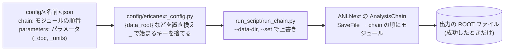
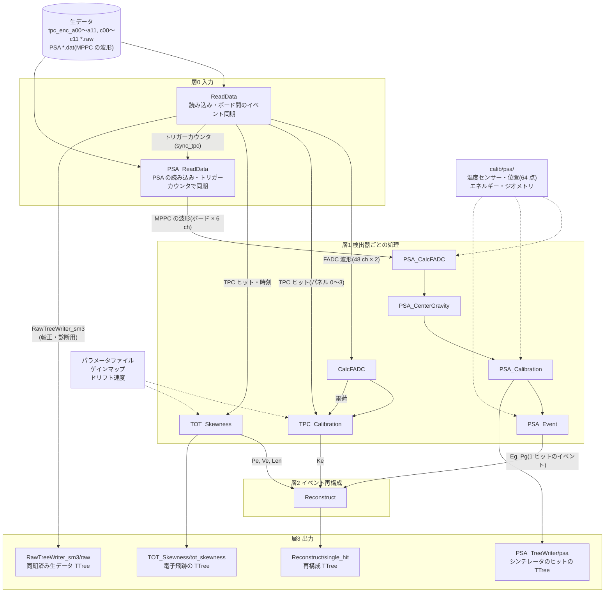

# EricaNext

**SMILE-3 プロジェクトのデータパイプライン**

EricaNext は、SMILE-3 プロジェクトの検出器生データ（detector raw data）から、
天体解析が可能なイベント再構成（event reconstruction）までを一貫して処理する
パイプラインソフトウェアです。

ANLnext フレームワークをベースに構築されており、解析モジュールを組み合わせて
データ処理フローを構成します。

SMILE-2+ のデータも、モジュールを `_2p` の付いたもの(EricaNext_try から取り込んだもの)に切り替えれば同じ EricaNext で扱えます(下の「SMILE-2+ のデータ」)。
SMILE-2+ のチュートリアルは [EricaNext_try](https://github.com/SMILE-tool-box/EricaNext_try) にあります。
このリポジトリの構成(`config/`、`run_script/`、`scripts/env/`)はそれに合わせています。

SMILE-3 の検出器の構成と SMILE-2+ からの変更点(μ-PIC の 4 分割、ストリップ 0.4 mm、MPPC の PSA)は
[`tutorials/0_Introduction`](tutorials/0_Introduction/Introduction.ipynb) にまとめています。

開発の引き継ぎ(環境の落とし穴、検証のやり方、残りの仕事)は [`AGENTS.md`](AGENTS.md) にあります。

## 使い方(まずここ)

実行するスクリプトは [`run_script/run_chain.py`](run_script/run_chain.py) です。**最初の引数に設定ファイル** を渡します。
設定ファイル [`config/<名前>.json`](config/) に、つなぐモジュールとそのパラメータ、データの場所をすべて書いておき、
スクリプトはそれを読んでチェーンを組んで実行します。

```bash
cd run_script

# TPC だけ(ReadData → CalcFADC → TPC_Calibration → TOT_Skewness): 設定ファイル smile3_tpc_only(= config/smile3_tpc_only.json)
python3 run_chain.py smile3_tpc_only -o out.root                    # 設定ファイルに書いたランの全イベント
python3 run_chain.py smile3_tpc_only -o test.root -n 10000          # 先頭 1 万イベント
python3 run_chain.py smile3_tpc_only -o out.root --data-dir ../mount_data/storage_g0/run_20260618T010203Z   # ランを変える

# シンチレータ(PSA)だけ: 波形の積分・位置・ピクセル(psa_decode.py + pixel_id.py と同じ)
python3 run_chain.py smile3_psa -o psa.root --data-dir ../mount_data/storage_g1/run_20261029T071524Z

# 複数のランをまとめて(1 ランに 1 ファイル)
bash run_runs.sh smile3_tpc_only ../root_data/board/output20_0618 ../mount_data/storage_g0/run_20260618*
```

- 設定ファイルは名前(拡張子なし)で書くと `config/` から探します。`.json` のパスを直接書いても構いません。
- 値を変えるときは、設定ファイルをコピーして書き換えるか、`--set モジュール.パラメータ=値` でその場だけ上書きします。
- 設定ファイルの各モジュールには、全パラメータの説明(`_doc`)と単位(`_units`)を書いています。書き方は [`config/README.md`](config/README.md)。
- 失敗すると終了コード 1 で終わり、出力ファイルは残しません。
- スクリプトの詳しい使い方は [`run_script/README.md`](run_script/README.md)。

| `run_chain.py` の引数 | 意味 |
| --- | --- |
| `<設定>` | 設定ファイル(必須) |
| `-o` | 出力の ROOT ファイル(必須) |
| `-n` | 処理するイベント数。省略すると全イベント |
| `--data-dir` | ランのディレクトリ(設定ファイルの `ReadData.data_dir`、`PSA_ReadData.data_dir` を置き換える) |
| `--set モジュール.パラメータ=値` | パラメータの上書き(何回でも)。小数は `10.0` のように書く |

## 解析チェーン

### 設定ファイルからチェーンを組む



モジュールの順番とパラメータはすべて設定ファイルに書き、スクリプトには書きません。
新しい解析の組み方を作るときは、`config/` に設定ファイルを足します(書き方は [`config/README.md`](config/README.md))。

| 設定ファイル | つなぐモジュール |
| --- | --- |
| [`smile3_tpc_only`](config/smile3_tpc_only.json) | `ReadData → CalcFADC → TPC_Calibration → TOT_Skewness`(TPC だけ。ゲインマップ無し、電子の飛跡まで) |
| [`smile3_raw`](config/smile3_raw.json) | `ReadData → RawTreeWriter_sm3`(同期した生データのツリー。較正・診断用) |
| [`smile3_psa`](config/smile3_psa.json) | `PSA_ReadData → PSA_CalcFADC → PSA_CenterGravity → PSA_Calibration → PSA_TreeWriter`(シンチレータだけ) |
| [`smile3_reconstruct`](config/smile3_reconstruct.json) | `ReadData → PSA_* → CalcFADC → TPC_Calibration → PSA_Event → TOT_Skewness → Reconstruct`(TPC + シンチレータ) |

### モジュールのつながり

SMILE-2+ から変わったのは検出器のセットアップ(μ-PIC の 4 分割、ストリップ 0.4 mm、HA の読み出しが MPPC)で、
解析の中身はほとんど同じです。そのためチェーンの構成は SMILE-2+ と同じにし、
**HA の部分だけを PSA(MPPC の波形)用の `PSA_*` モジュールに作り直しました**。



- 実線の矢印はデータの受け渡し(ラベルは渡すもの)、点線の矢印はパラメータファイルの読み込みです。
- 実際の実行順は設定ファイルの `chain` の順です。TPC と PSA を一緒に読むときは `ReadData` を `PSA_ReadData` より前に置きます
  (`PSA_ReadData.sync_tpc: true` で `ReadData` のトリガーカウンタに合わせて読む)。
- ゲインマップは `TPC_Calibration.NoCalData: false` のときだけ読みます。
- PSA の部分は `analysis_sm3_FM/PSA_analysis` の `psa_decode.py` → `pixel_id.py` と同じ計算です
  (同じ .dat で、ヒット・peak_id・ピクセルは全部一致、hg などは Python の float32 の丸めの範囲で一致)。
  較正ファイルは [`calib/psa/`](calib/psa/)(作り方は [`config/README.md`](config/README.md#psa-の較正ファイル-calibpsa))。
- `Reconstruct` は `PSA_Event`(`PSA_SingleHit` のイベント)を使います。SMILE-2+ の HA(PMT)は `Reconstruct_2p` と `HA_Calc_2p` です。
- ジオメトリ `calib/psa/geometry.csv` は、CAD の STEP ファイルと HA の配置図から `scripts/calib/make_psa_geometry.py` で作りました(ピクセルの向きはデータでの確認がまだ)。
  エネルギー(`energy_haNN.csv`)とジオメトリが無いブロックのヒットは、`PSA_Event` が使いません。
  `CalcFADC` と `TPC_Calibration` はイベントを飛ばしません(SMILE_tool_box と同じ)。`TPC_Calibration` は TPC のエネルギーがあるイベントに `TPC_Ee_Valid` の印を付けます。
  `Reconstruct` は、シンチレータの 1 ヒット(`PSA_SingleHit`)と TPC のエネルギー(`TPC_Ee_Valid`)の両方があるイベントだけを書きます。
  飛跡(`TOT_Ve_TRA`)があれば、幾何の α(`cos_alpha_geo`)と入射ガンマ線の方向(`Vi`)も書きます(SMILE_tool_box の Reconstruct と同じ式)。
  `source_position` を書けば ARM と SPD も出します。TPC の位置とシンチレータのジオメトリが同じ座標系かは、まだ確かめていません。

| モジュール | すること | 主な出力(`SaveFile` の ROOT ファイルの中) |
| --- | --- | --- |
| `SaveFile` | 出力の ROOT ファイルを開く(`run_chain.py` が先頭に必ずつなぐ) | |
| `ReadData` | 生データを読み、ボード間でイベント ID をそろえる | 波形・ヒットは `RawTreeWriter_sm3` で保存。積算・選別・描画は保存後に行う |
| `CalcFADC` | FADC 波形からベースラインを引いて電荷を積分し、`TPC_Calibration` に渡す | なし(ベースライン・電荷の分布と 1-hit スペクトルは、生データのツリーから `scripts/calib/make_tpc_spec1hit.py` で後段で作る) |
| `TPC_Calibration` | 電荷とゲインマップから反跳電子のエネルギー | `TPC_Calibration/`: `Spectrum` など |
| `TOT_Skewness` | 飛跡から散乱点 `Pe`、電子の方向 `Ve`、飛程 `Len` | `TOT_Skewness/tot_skewness`(TTree) |
| `PSA_ReadData` | PSA の生データ `ha<NN>_<番号>.dat` を全ボード読み、トリガーカウンタでイベントをそろえる(`ReadData` があればそれに合わせる)。別の storage は `extra_data_dirs` | `PSA_ReadData/HitPattern` |
| `PSA_CalcFADC` | 波形のペデスタルを引いてピークの周りを積分(`hg`, `lg`)、温度センサーの較正 | `PSA_CalcFADC/HG_haNN`, `LG_haNN` |
| `PSA_CenterGravity` | 4 隅の信号の重心 `x_hg`, `y_hg`(`x_lg`, `y_lg`) | `PSA_CenterGravity/Map_haNN_chC` |
| `PSA_Calibration` | 位置の補正(64 点の薄板スプライン)、ピクセル (n, m)、エネルギー | `PSA_Calibration/Corrected_haNN_chC`, `PixelHG_haNN`, `Energy_haNN` |
| `PSA_TreeWriter` | PSA のヒットを 1 ヒット 1 行で書く | `PSA_TreeWriter/psa`(TTree) |
| `PSA_Event` | ピクセルとジオメトリから吸収点 `Pg` [mm]、使えるヒットの数(`PSA_SingleHit` / `MultiHit` / `NoHits`)。`Reconstruct` に渡す | `PSA_Event/NHits`, `SingleHitEnergy` |
| `Reconstruct` | TPC と PSA(`PSA_Event`)を合わせたイベント再構成。運動学の角度、飛跡があれば幾何の α と入射ガンマ線の方向 | `Reconstruct/single_hit`(TTree、`evt_id` = トリガーカウンタ) |
| `RawTreeWriter_sm3` | ボード間でそろえた TPC の生データ(ヒット、エンコーダーのレコード、FADC 波形、時刻)を 1 イベント 1 行で書く。`ReadData` の直後につなぐ | `RawTreeWriter_sm3/raw`, `RawTreeWriter_sm3/run_info`(TTree) |

### SMILE-2+ のデータ(`*_2p` のモジュール)

EricaNext_try の SMILE-2+ 用のモジュールを、名前に `_2p` を付けて取り込んでいます(中身は EricaNext_try と同じ。モジュールの間の参照も `_2p` の名前)。
ANLNext はモジュールを名前で探すので、SMILE-3 と SMILE-2+ のモジュールは別の名前にしてあります。SMILE-3 のモジュールの名前は変えていません。

| モジュール | SMILE-3 で対応するもの |
| --- | --- |
| `ReadData_2p` | `ReadData`(SMILE-2+ の `uTPC_*.raw`、`HA*.raw`) |
| `CalcFADC_2p`, `TPC_Calibration_2p`, `TOT_Skewness_2p` | `CalcFADC`, `TPC_Calibration`, `TOT_Skewness` |
| `HA_CenterGravity_2p`, `HA_Calc_2p` | `PSA_*`, `PSA_Event`(SMILE-2+ の HA は PMT の ADC) |
| `Reconstruct_2p` | `Reconstruct` |
| `RawTreeWriter_2p` | `RawTreeWriter_sm3` |

設定ファイルは `config/smile2p_*.json` と `config/tpc_caldata_2017_Ba133.json` です。データは EricaNext_try と同じ場所(環境変数 `SMILE2P_DATA`、無ければ研究室の NAS)を読みます。

```bash
cd run_script
python3 run_chain.py smile2p_20190701_Per02 -o per02_out.root
python3 run_chain.py smile2p_20190701_Per02 -o raw.root --raw -n 10000 --compression 505
```

Per02 の最初の 3000 イベント(`TOT_Skewness_2p/tot_skewness`、`Reconstruct_2p/single_hit`)と `--raw` の 2000 イベントで、EricaNext_try の出力と全部の列が一致することを確かめています。

- イベント ID には、ボードのトリガーカウンタを使います(`ReadData.event_id: true`)。
  すべてのボードで同じ ID になるまで、小さい ID のボードを読み進めてそろえます。

---

## 依存関係

| ソフト | 版 | |
| --- | --- | --- |
| [ANLnext](https://github.com/odakahirokazu/ANLNext) | c22eb3e で確認 | EricaNext_try の `~/opt/anlnext-g4` でもよい |
| [ROOT](https://root.cern/) | 6.36 で確認 | |
| [Boost](https://www.boost.org/) | 1.80.0 以降 | |
| CMake | 3.8 以降 | |
| C++ コンパイラ | C++17 | |
| [SWIG](https://www.swig.org/) | | Python 拡張の生成に必須 |
| Python 3 | | |

---

## インストール

### 0. EricaNext を取ってくる

```bash
git clone https://github.com/SMILE-tool-box/EricaNext.git      # SSH の鍵を登録していれば git@github.com:SMILE-tool-box/EricaNext.git
cd EricaNext
```

以下のコマンドは、このリポジトリの一番上のディレクトリで実行します。

### 1. ANLnext を入れる

先に ANLnext をインストールしておきます(手順は ANLnext のドキュメントを参照)。
EricaNext_try を入れてあれば、その ANLNext(`~/opt/anlnext-g4`)を使えます。その場合は先に `source ~/opt/setup_ericanext.sh` します
(この ANLNext は `import anlnext` だけでも Geant4 のライブラリを使うため)。

### 環境を確認する

使用するPythonとROOT・ANLNextの環境を有効にした後、まず確認します。
`~/opt/setup_ericanext.sh` は開発者環境の例で、このリポジトリには含まれません。
各自のROOT・ANLNextの設定スクリプトを使ってください。

```bash
# ビルド前：ツール、Python開発ヘッダー、ANLNextのimportを確認
python3 scripts/env/check_environment.py --mode build

# ビルド後：EricaPyと、較正・ノートブック用の依存関係も確認
python3 scripts/env/check_environment.py --mode all
```

`OK` / `NG` と対処の案内を表示し、NGがあれば終了コード1になります。
データを読まず、パッケージのインストールやビルドは行いません。
Boostの検出・リンクや依存関係全体の整合は、実際のCMakeビルドで確認します。

Pythonが複数ある場合は、用途ごとに明示できます（パスは各自のものに置き換えます）。

```bash
python3 scripts/env/check_environment.py --mode all \
  --python /path/to/chain/python \
  --analysis-python /path/to/analysis/python
```

`--python` はANLNext・EricaPyのビルドとチェーン実行に使うPython、
`--analysis-python` はPyROOT・numpy・scipy・matplotlib・Jupyterを使うPythonです。
後者を省略すると前者と同じPythonを確認します。
チェーンだけなら `--mode run`、解析用Pythonだけなら `--mode notebook` で確認できます。
カーネル表示名「EricaNext」は登録済みであることを前提にしません。

### 2. EricaNext をビルドする

```bash
export ANLNEXT_INSTALL=<ANLnext のインストール先>      # setup_ericanext.sh を読んだなら不要
bash scripts/env/build_ericanext.sh
```

`build/` でビルドし、リポジトリの `install/` に入れます(`/usr/local` には入れないので `sudo` は要りません)。
`run_script/run_chain.py` は `install/lib/python` の `EricaPy` を自分で読み込むので、`PYTHONPATH` を設定しなくても動きます。
コードを直したあとも同じコマンドでビルドし直します。

手で実行するときは次と同じです。

```bash
mkdir build install && cd build
cmake ../source -DCMAKE_INSTALL_PREFIX=../install -DANLNEXT_INSTALL=$ANLNEXT_INSTALL -DPython3_EXECUTABLE=$(which python3)
make -j8 && make install
```

| オプション | 説明 |
| --- | --- |
| `-DCMAKE_INSTALL_PREFIX=../install` | インストール先。`run_script/run_chain.py` はリポジトリの `install/lib/python` を読むので、この場所のままにする(未指定だと `$HOME`) |
| `-DANLNEXT_INSTALL=...` | ANLnext の場所(未指定なら環境変数 `ANLNEXT_INSTALL`、それも無ければ `$HOME`) |
| `-DPython3_EXECUTABLE=...` | Python が何種類も入っている環境(conda / pyenv / system など)で、使う Python を固定する(`CreateSwigPython.cmake` は `find_package(Python3 ...)` を使う。ANLnext を入れたときと同じ Python にする) |
| `make -j8` | ビルドの並列数。使うコア数に合わせて変える |

`USE_PYTHON` は `source/CMakeLists.txt` で `ON` になっているので指定は要りません。

---

## データの置き場所

設定ファイルの `ReadData.data_dir` は `{data_root}/storage_g0/run_<日時>` のように書き、`{data_root}` は読み込むときに次に置き換わります
(`config/ericanext_config.py`)。

| 優先 | 場所 |
| --- | --- |
| 1 | 環境変数 `SMILE3_DATA` |
| 2 | このリポジトリの `mount_data/`(`ericanext_config.py` の `DATA_DIR`) |

中の並び:

```
<data_root>/
  storage_g0/
    run_20260628T232149Z/        1 ラン: tpc_enc_a<ボード>_<番号>.raw, tpc_enc_c<ボード>_<番号>.raw
    ...
```

ほかの場所を探すことはしません。`<data_root>` に `storage_g*/` が無いときは、どのディレクトリを見たかを警告します。
1 つのランだけなら、`--data-dir` にランのディレクトリを直接渡しても構いません。

## リポジトリの構成

| 場所 | 中身 |
| --- | --- |
| [`source/`](source/) | モジュール(C++)と Python 拡張 `EricaPy` |
| [`config/`](config/README.md) | 設定ファイル(チェーンとパラメータ)と読み込み(`ericanext_config.py`) |
| [`tutorials/`](tutorials/README.md) | チュートリアル(まず `0_Introduction` で SMILE-3 の構成と SMILE-2+ からの変更点) |
| [`run_script/`](run_script/README.md) | 実行スクリプト(`run_chain.py`, `run_runs.sh`)と図を描くスクリプト |
| [`scripts/env/`](scripts/env/) | ビルドのスクリプト |
| `mount_data/`, `root_data/` | データと出力の置き場所(git では管理しない) |
