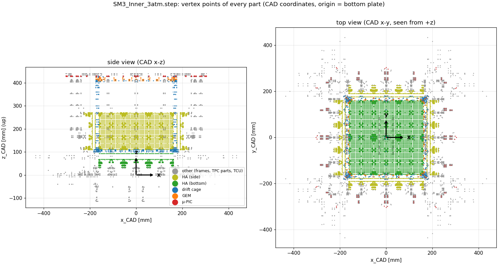
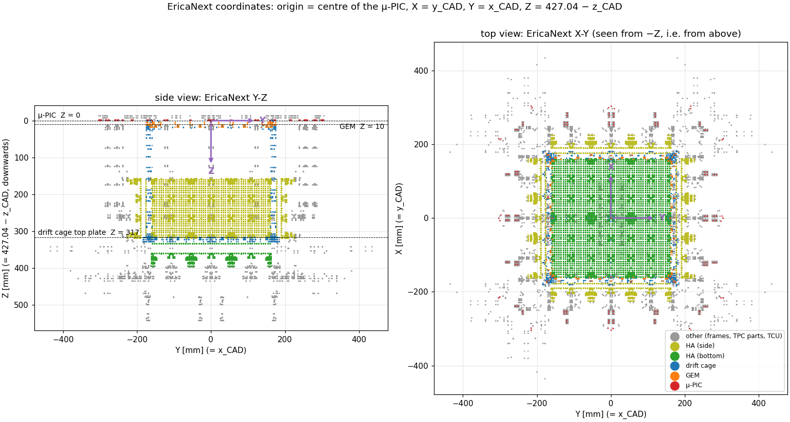

# 検出器の座標系

SMILE-3 の内部（3 気圧の容器の中）の CAD と、EricaNext で使う座標系をまとめたフォルダです。

## ファイル

| ファイル | 中身 |
| --- | --- |
| `SM3_Inner_3atm.step` | SMILE-3 の内部の組み立て（TPC、μ-PIC、GEM、ドリフトケージ、底面と側面の HA のモジュール）。2026-11-06 に Autodesk の CAD から書き出した STEP（AP214） |
| `cad_view.png` | CAD の各部品の頂点を、CAD の座標のまま描いた図（横から見た図と上から見た図） |
| `coordinates.png` | 同じ部品を EricaNext の座標で描き、座標軸と μ-PIC・GEM・天板の位置を書き込んだ図 |

図は次のコマンドで作り直せます（CAD のライブラリは要りません）。

```bash
/usr/bin/python3 scripts/calib/plot_detector_coordinates.py calib/detector_coordinates/SM3_Inner_3atm.step -o calib/detector_coordinates
```

## CAD の図



STEP に入っている各部品の頂点を点で描いています。面は描いていません。
色は部品の種類で、赤が μ-PIC、橙が GEM、青がドリフトケージ、緑が底面の HA、黄緑が側面の HA、灰色がそのほか（フレーム、TPC の部品、TCU）です。

CAD の座標は、原点が底板、z が上向きです。

## EricaNext の座標系



| | EricaNext | CAD との関係 |
| --- | --- | --- |
| 原点 | μ-PIC の中央（μ-PIC の基板の下の面） | CAD の (x, y, z) = (0, 0, 427.04 mm) |
| X | 西 → 東 | X = y_CAD |
| Y | 北 → 南 | Y = x_CAD |
| Z | 下向き（ドリフト領域の方向） | Z = 427.04 − z_CAD |

CAD で確かめた寸法（EricaNext の Z）:

| 位置 | Z |
| --- | --- |
| μ-PIC | 0 mm |
| GEM | 10.0 mm |
| ドリフトケージの天板の内側の面 | 317.0 mm |

座標系の説明は [tutorials/0_Introduction](../../tutorials/0_Introduction/Introduction.ipynb) にもあります。

## 使い道

- `scripts/calib/make_psa_geometry.py` が、このファイルから `calib/psa/geometry.csv`（PSA_Event が使う HA のブロックの位置と向き）を作ります。
- STEP の組み立ての木は `scripts/calib/step_reader.py` で読みます。部品と大きさの一覧は次のコマンドで見られます。

  ```bash
  /usr/bin/python3 scripts/calib/step_reader.py calib/detector_coordinates/SM3_Inner_3atm.step '<部品の名前の正規表現>'
  ```
- シミュレーター（Geant4）の配置も、このファイルからそろえる予定です（AGENTS.md の残りの仕事）。
